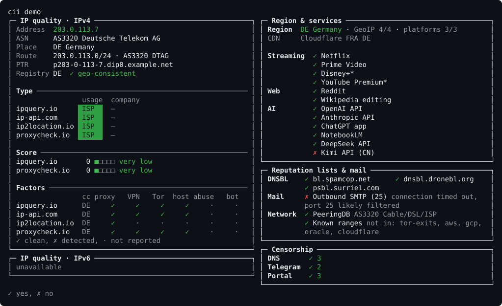

# cii

[Русский](README.md)

[](https://github.com/arngory/cii/releases/latest)
[](https://github.com/arngory/cii/actions/workflows/ci.yml)
[](LICENSE)

**cii — complete information about current IP.** One static binary shows where your IP appears to be, how clean it is, what works and what is blocked from here, how traffic is routed and how fast the link is.

<picture>
  <source media="(max-width: 700px)" srcset="docs/img/demo-en-narrow.svg">
  
</picture>

## Run

Linux and macOS:

```bash
curl -fsSLo cii "https://github.com/arngory/cii/releases/latest/download/cii-$(uname -s | tr A-Z a-z)-$(uname -m | sed 's/x86_64/amd64/;s/aarch64/arm64/;s/armv7l/arm-7/;s/i[3-6]86/386/')" && chmod +x cii && ./cii
```

Windows (PowerShell):

```powershell
iwr https://github.com/arngory/cii/releases/latest/download/cii-windows-amd64.exe -OutFile cii.exe; .\cii.exe
```

Without arguments cii shows a menu of modes; a number or flags can be appended right away: `./cii 2m`. Homebrew, Scoop, Docker, packages and signature verification are in [docs/en/INSTALL.md](docs/en/INSTALL.md).

## What it checks

| Area | What is inside | Details |
|---|---|---|
| IP quality | address type, risk scores, proxy, VPN, Tor, hosting, blocklists, mail | [RISK_CHECKS](docs/en/RISK_CHECKS.md) |
| Region | country by GeoIP databases and as platforms see it, CDN nodes | [REGION_CHECKS](docs/en/REGION_CHECKS.md) |
| Services | streaming, AI, sites; regional catalogues | [SERVICE_CHECKS](docs/en/SERVICE_CHECKS.md) |
| Censorship | DNS, port 53 interception, DPI, geoblocking, Telegram, captive portal | [CENSOR_CHECKS](docs/en/CENSOR_CHECKS.md) |
| Routes | paths to major networks: direct, transit, detour | [ROUTE](docs/en/ROUTE.md) |
| Benchmark | system, disk, CPU, speed, iperf3 | [BENCH](docs/en/BENCH.md) |

cii only contacts destinations it declared up front (`cii --plan` prints all of them), sends nothing anywhere and uses no one else's keys: [network policy](docs/en/NETWORK_POLICY.md).

## Documentation

- [Usage](docs/en/USAGE.md): menu, commands, flags, log, `--mask`
- [Installation](docs/en/INSTALL.md) and [configuration](docs/en/CONFIG.md)
- [Offline databases and data licences](docs/en/DATA_SOURCES.md)
- For developers (in Russian): [architecture](docs/ARCHITECTURE.md), [build and releases](docs/DEVELOPMENT.md), [roadmap](docs/ROADMAP.md), [credits](CREDITS.md)

## Licence

[AGPL-3.0](LICENSE). DB-IP data is CC BY 4.0, IPinfo Lite is CC BY-SA 4.0.
