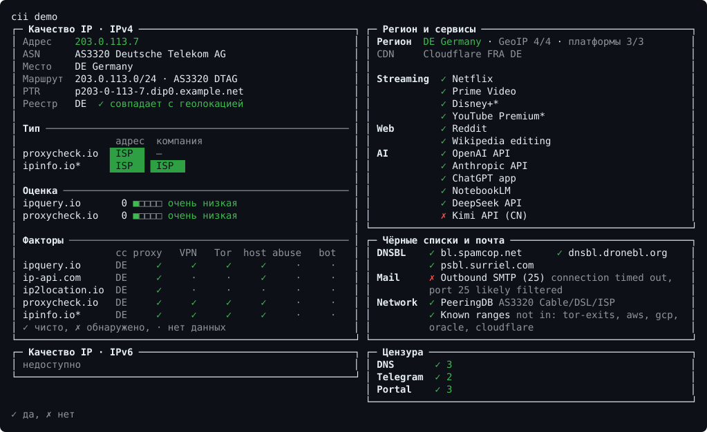

# cii

[English](README.en.md)

[](https://github.com/arngory/cii/releases/latest)
[](https://github.com/arngory/cii/actions/workflows/ci.yml)
[](LICENSE)

**cii — complete information about current IP.** Один статический бинарник показывает, где «находится» ваш IP, насколько он чистый, что из этой точки доступно и что блокируется, какими путями идёт трафик и какая скорость.

<picture>
  <source media="(max-width: 700px)" srcset="docs/img/demo-ru-narrow.svg">
  
</picture>

## Запуск

Linux и macOS:

```bash
curl -fsSLo cii "https://github.com/arngory/cii/releases/latest/download/cii-$(uname -s | tr A-Z a-z)-$(uname -m | sed 's/x86_64/amd64/;s/aarch64/arm64/;s/armv7l/arm-7/;s/i[3-6]86/386/')" && chmod +x cii && ./cii
```

Windows (PowerShell):

```powershell
iwr https://github.com/arngory/cii/releases/latest/download/cii-windows-amd64.exe -OutFile cii.exe; .\cii.exe
```

Без параметров cii показывает меню режимов; номер или флаги можно дописать сразу: `./cii 2m`. Homebrew, Scoop, Docker, пакеты и проверка подписи — в [docs/INSTALL.md](docs/INSTALL.md).

## Что проверяет

| Раздел | Что внутри | Подробнее |
|---|---|---|
| Качество IP | тип адреса, оценки риска, прокси, VPN, Tor, хостинг, чёрные списки, почта | [RISK_CHECKS](docs/RISK_CHECKS.md) |
| Регион | страна по GeoIP-базам и по мнению платформ, CDN-узлы | [REGION_CHECKS](docs/REGION_CHECKS.md) |
| Сервисы | стриминг, AI, сайты; региональные каталоги | [SERVICE_CHECKS](docs/SERVICE_CHECKS.md) |
| Цензура | DNS, перехват 53-го порта, DPI, геоблокировки, Telegram, captive-портал | [CENSOR_CHECKS](docs/CENSOR_CHECKS.md) |
| Маршруты | пути к крупным сетям: напрямую, транзит, крюк | [ROUTE](docs/ROUTE.md) |
| Бенчмарк | система, диск, CPU, скорость, iperf3 | [BENCH](docs/BENCH.md) |

cii обращается только к адресам, которые объявил заранее (`cii --plan` печатает их все), ничего никуда не отправляет и не пользуется чужими ключами: [сетевая политика](docs/NETWORK_POLICY.md).

## Документация

- [Использование](docs/USAGE.md) — меню, команды, флаги, лог, `--mask`
- [Установка](docs/INSTALL.md) и [конфигурация](docs/CONFIG.md)
- [Офлайн-базы и лицензии данных](docs/DATA_SOURCES.md)
- Разработчикам: [архитектура](docs/ARCHITECTURE.md), [сборка и релизы](docs/DEVELOPMENT.md), [план](docs/ROADMAP.md), [благодарности](CREDITS.md)

## Лицензия

[AGPL-3.0](LICENSE). Данные DB-IP — CC BY 4.0, IPinfo Lite — CC BY-SA 4.0.
